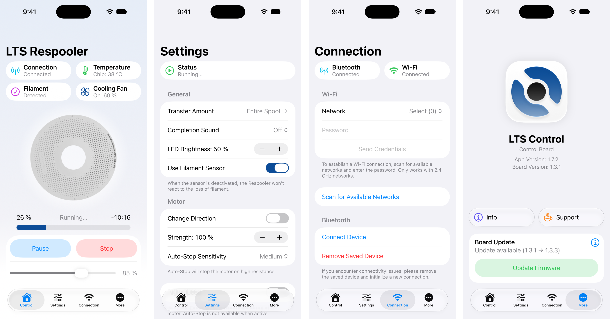

# ⚙️📱 LTS Control for iOS

LTS Control for iOS is the companion app for the [LTS Respooler](https://github.com/LukasT03/LTS-Respooler). The app allows you to connect via Bluetooth Low Energy (BLE), monitor spool progress, and adjust key settings such as speed, transfer amount, and motor strength.

It’s primarily built with SwiftUI to be as platform-native as possible and supports Live Activities. It's my first iOS app so the code might be a bit messy!

➡️ Download [here](https://apps.apple.com/app/lts-control/id6742149969)!

## 📸 Showcase

## 📋 License

This project is licensed under the Mozilla Public License 2.0 (MPL 2.0). You’re free to use, modify, and share the code in your own projects. If you make changes and distribute them, just keep those modified files open under the same license.

Contributions, modifications, and improvements are very welcome! :)
